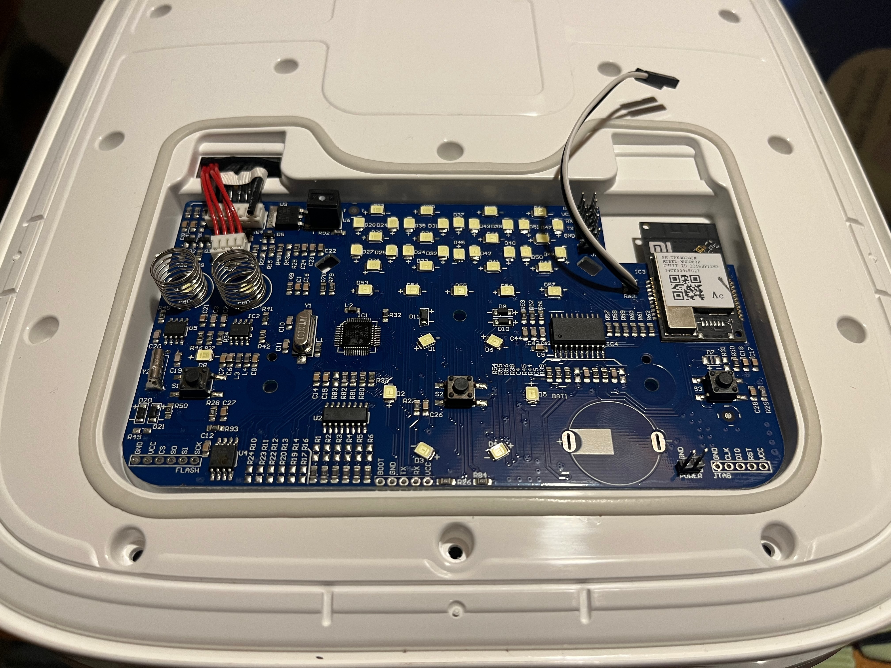

# ESPHome Xiaomi Rice Cooker (IHFB01CM)

Alternative strictly-local firmware for the Xiaomi IH Rice Cooker
(`IHFB01CM`, miIO `chunmi.cooker.normal2`).

Replaces the original firmware on the MHCW03P Wi-Fi module (ESP8285) with ESPHome that speaks the stock UART dialogue to the cooker's own host MCU. Heater control, thermal protection, display, buttons, and buzzer all stay stock. Only low-voltage lid-board systems are ever accessed. No mains power is ever switched by the ESP module.

## Safety

- Appliance controller MCU (NXP LPC1100 ARM Cortex-M0) autonomously enforces all thermal safety margins, induction inverter drive, and pot detection loops.
- Heater base stays **unplugged from mains** during bench flashing. Use an external 5V bench supply for the main logic board, preferably with OCP.

## Disclaimer

This is an independent community reverse-engineering project and is not affiliated with, endorsed by, or associated with Xiaomi Inc., Mijia, Chunmi, or their subsidiaries. All product names, trademarks, and registered trademarks are the property of their respective owners.

This firmware and documentation are provided "as is", without warranty of any kind. 

Working on appliances that connect to AC mains electricity carries inherent risks of electric shock, fire, or burns. Always disconnect the cooker completely from AC mains power before servicing or flashing the low-voltage logic board.

This project heavily relied on agentic coding tools to analyze the original firmware, reverse engineer the serial protocol, and implement a custom ESPHome component that speaks the same protocol to the cooker MCU.


## Usage in Your Local ESPHome Config

To use this firmware in your own ESPHome setup without cloning the entire repository, reference the pre-built package directly in your YAML (see [`example.yaml`](example.yaml)):

```yaml
substitutions:
  name: "xiaomi-rice-cooker"
  friendly_name: "Xiaomi Rice Cooker"

packages:
  rice_cooker: github://mathismueller/esphome-xiaomi-rice-cooker/packages/cooker.yaml@main

# Provide your local network and API credentials:
wifi:
  ssid: !secret wifi_ssid
  password: !secret wifi_password
  ap:
    ssid: !secret fallback_ap_ssid
    password: !secret fallback_ap_password

api:
  encryption:
    key: !secret api_encryption_key
```

## Flashing and Development

To build and flash locally using the repository's development configuration [`dev.yaml`](dev.yaml):

```sh
uv sync                               # project-pinned esphome, esptool, pyserial
uv run esphome compile dev.yaml       # compile firmware
uv run esphome upload --device <IP> dev.yaml # OTA flash
```

If you do not intent to clone the repository, you can also use the pre-built package directly in your own ESPHome config (see previous section).



Quick flashing guide: 
1. Remove the lid cover, starting from the hinge with a lot of those plectrum-like tools. The clips should not fight back too much (see the `images/` folder for close ups).
2. Take apart the two halves of the cover (there are lots of screws) to access the main logic board. You want to undo the cable guides. This step is rather self-explanatory.
3. Take off the main logic board by undoing three screws and the two clips. You can then turn it over and put away the top half of the cover. 
4. Solder in four places: 5V and GND on the bottom for power, GND on one of the UART headers and TX/RX on the two holes on the left side of the WiFi module. Last, add headers to the JW connector.
5. Add a bench power supply to the 5V and GND pads. Make sure the supply is off before connecting.
6. Connect a USB-to-UART adapter to the UART header (GND, TX, RX). Make sure the adapter is set to 3.3V logic level. The top hole is U0RXD / GPIO_3 ant he bottom is U0TXD / GPIO_1 when the board is oriented with the WiFi module on the right side.
7. Bridge the JW connector with a jumper to put the device in flash mode (bridges GND to GPIO0), turn on the PSU and start the flashing process. I would recommend performing a firmware dump prior to flashing with esptool (the command should be in the documentation).

See [Bench Feasibility & Flashing Guide](research/2026-09-25%20feasibility.md) for the full bench procedure. 

## Documentation

Detailed technical documentation is available under [`documentation/`](documentation/) and [`research/`](research/):

- [Hardware & Pinout Reference](documentation/hardware-and-pinout.md) — Silicon identification, pinouts for headers (UART1, UART2, Flash port, JW), and bench power setup.
- [Serial Protocol Specification](documentation/serial-protocol.md) — Line-based 115200 8N1 protocol, downlink commands, 12-element status array schema, async event codes, and command queue architecture.
- [Firmware Analysis & Flash Layout](documentation/firmware-analysis.md) — 2MB SPI flash geometry, bootloader, user1 miIO binary, embedded NXP LPC11xx MCU binary, and OTA mechanism.
- [ESPHome Implementation Architecture](documentation/esphome-architecture.md) — Custom `chunmi_cooker` external component design, C++ classes, Home Assistant entity models, and native API services.
- [Cooking Profile Format & Stage Curves](research/2026-10-14%20cooking%20profile%20format.md) — Binary profile format, 242-char schema, CRC-16 checksum, and custom profile generator.
- [MCU Control & Thermodynamics](research/2026-10-14%20mcu%20cooking%20control%20and%20thermodynamics.md) — Microcontroller heating curves, phase transitions, and inverter modulation.
- [Bench Setup & Feasibility](research/2026-09-25%20feasibility.md) — Bench wiring, safety checklist, UART headers, and expected signatures.

## Home Assistant Integration

The firmware exposes full telemetry and control directly to Home Assistant without cloud dependencies:

* **Control & Presets**: Menu selector, cycle stop/cancel, and one-touch start buttons for Quick Rice, Standard Rice, Porridge, Keep Warm, Cooking/Steam, Cake, Stored Favorite, Sushi Rice (Experimental), and 30-minute Express Rice (Experimental).
* **Telemetry**: Real-time mode, cooking phase/stage, countdown timer, ambient/cooking temperature, pot interlock detection, auto keep-warm toggle, and stored favorite profile.
* **Safety & Diagnostics**: Dedicated error text sensor (`sensor.error_description`) with granular hardware fault descriptions, last lid button pressed, and hardware/firmware revision info.
* **Native API Actions / Services**: Call actions from Home Assistant automations or Developer Tools (`set_interaction`, `set_led_timeout`, `set_lid_warning_timeout`, `set_alarm_delay`, `send_raw_command`). See [Architecture Reference](documentation/esphome-architecture.md#41-home-assistant-native-api-services--actions) for parameters and syntax.


## Layout

- [`components/`](components/) — custom `chunmi_cooker` ESPHome external component.
- [`packages/`](packages/) — reusable ESPHome package ([`packages/cooker.yaml`](packages/cooker.yaml)).
- [`dev.yaml`](dev.yaml) — local development configuration (includes local components).
- [`example.yaml`](example.yaml) — reference configuration for external users importing from GitHub.
- [`documentation/`](documentation/) — structured technical guides, hardware pinouts, and protocol specs.
- [`research/`](research/) — chronological notes (teardown, feasibility, protocol, implementation logs).
- [`images/`](images/) — teardown photos (descriptive names).
- [`scripts/`](scripts/) — bench helpers and profile generator ([`scripts/generate_custom_profile.py`](scripts/generate_custom_profile.py)).
- `tmp/` — captures, dumps, scratch (git-ignored, never committed).

## Acknowledgements

- **[ESPHome](https://esphome.io/)** — The outstanding open-source firmware framework.
- **[daniel-dona/MFB120A-1](https://github.com/daniel-dona/MFB120A-1)** — Daniel Dona's ESP32-based custom firmware project for the Xiaomi MFB120A-1 rice cooker, which let me know that some cookers are ESP-based.
- **[python-miio](https://github.com/rytilahti/python-miio)** — Teemu Rytilahti and contributors for the `miiocli` tool suite that made it possible to initially probe the appliance over the local network, determine the miIO model (`chunmi.cooker.normal2`), and identify the underlying ESP8266/ESP8285 SoC.
- **[MiEcosystem/miio_open](https://github.com/MiEcosystem/miio_open/tree/master/wifi/)** — Xiaomi's open IoT documentation for providing the hardware pinouts and UART specifications for the MHCW03P Wi-Fi module.
- **[aquarat's Xiaomi Precision Induction Cooker Teardown](https://aquarat.co.uk/2021/04/05/xiaomi-precision-induction-cooker-teardown/)** — Aaron ([@aquarat](https://github.com/aquarat)) for the detailed teardown of the related cooker using the same MHCW03P module, which provided the vital lead linking to the `miio_open` pinout repository.
## License

This project is licensed under the [MIT License](LICENSE).
