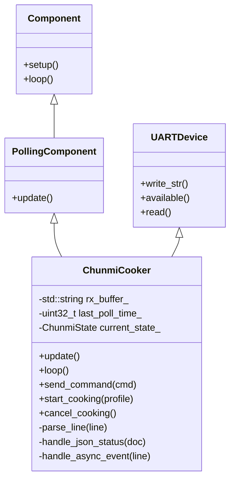

# ESPHome Implementation Architecture: `chunmi_cooker`

This document details the software architecture, component model, safety invariants, and Home Assistant entity mapping for the custom ESPHome component (`chunmi_cooker`) targeting the Xiaomi IH Rice Cooker (`IHFB01CM`).

---

## 1. Architectural Principles

1. **Strict Local Control**: All network interactions occur locally via ESPHome Native API or MQTT; zero cloud dependencies.
2. **Read-First / Safety-Guarded Control**: The component respects the physical partition between IoT and appliance safety. It interacts with the cooker exclusively through high-level protocol commands (`set_start`, `set_func`).
3. **Fail-Safe Operation**: If the ESP8285 crashes, boots into safe mode, or loses Wi-Fi connection, the host MCU's cooking cycle is unaffected.

---

## 2. Component File Layout

The component will be developed as an ESPHome local external component under `components/chunmi_cooker/`:

```
components/chunmi_cooker/
├── __init__.py               # Core Python schema, UART device registration
├── chunmi_cooker.h           # C++ header: ChunmiCooker class, states, enums
├── chunmi_cooker.cpp         # C++ implementation: UART loop, ArduinoJson parser
├── sensor.py                 # Sensors: temperature, remaining time, duration
├── text_sensor.py            # Text sensors: operation mode, cooking stage
├── binary_sensor.py          # Binary sensors: inner pot present, fault error
├── button.py                 # Buttons: start standard rice, cancel/stop
└── select.py                 # Select: cooking profile picker
```

---

## 3. C++ Component Class Architecture



### 3.1 Lifecycle & Execution Loop
- **`setup()`**:
  - Configures UART baud rate (`115200`).
  - Sends initial network announcement: `down MIIO_net_change local\r`.
  - Clears RX buffers and state machines.
- **`update()` (Polling Interval, e.g. 2s)**:
  - Transmits status query: `down get_prop "all"\r`.
- **`loop()` (Every ESPHome cycle)**:
  - Drains UART receive FIFO into `rx_buffer_`.
  - Splits incoming data on `\r\n` line delimiters.
  - Passes complete lines to `parse_line()`.

### 3.2 Parsing Strategy
1. **JSON Detection**: If line starts with `{"result":` or `{"id":`:
   - Deserializes using `ArduinoJson` (built into ESPHome).
   - Extracts 12-element status array from `doc["result"]`.
   - Dispatches values to registered sensor pointers.
2. **Event Detection**: If line starts with `event `:
   - Identifies alarms: `event nopan` updates pot presence binary sensor; `event *bad` or `event *high` triggers fault state and diagnostic sensors.
3. **Property Updates**: If line starts with `props `:
   - Handles button press feedback and operational transitions.
4. **Command Acknowledgment**: If line is `result "0"` or `ok`:
   - Confirms successful execution of outgoing commands.

---

## 4. Home Assistant Entity Model

| Entity Category | Entity Name | Type | Source Field / Event | Description |
| :--- | :--- | :--- | :--- | :--- |
| **Status** | Cooker Mode | `text_sensor` | Status Array Index 0 (`func`) | `waiting`, `running`, `autokeepwarm`, `error` |
| **Status** | Cooker Stage | `text_sensor` | Status Array Index 2 (`stage`) | Current cooking phase (e.g. "Idle", "Boiling", "Braising") |
| **Status** | Cooker Menu | `text_sensor` | Status Array Index 1 (`menu`) | Selected recipe: Standard Rice, Quick Rice, Porridge, Keep Warm, Favorite / Custom |
| **Status** | Cooker Last Button | `text_sensor` | `props button_pressed` / Actions | Name of the last pressed physical or virtual button |
| **Status** | Cooker Last Event | `text_sensor` | `event *` lines | Most recent hardware event/alarm notification |
| **Sensor** | Cooker Temperature | `sensor` | Status Array Index 3 (`temp`) | Ambient pot temperature in °C |
| **Sensor** | Cooker Remaining Time | `sensor` | Status Array Index 4 (`t_func`)| Countdown timer in minutes |
| **Sensor** | Cooker Program Duration | `sensor` | Status Array Index 6 (`t_cook`)| Total profile cooking duration in minutes |
| **Binary Sensor**| Inner Pot Present | `binary_sensor`| `event nopan` / Status | `ON` when pot is inserted, `OFF` when removed |
| **Binary Sensor**| Cooker Error | `binary_sensor`| Status index 0 / `event *` | `ON` if any safety cutoff is active |
| **Control** | Cooker Cancel / Stop | `button` | Sends `down set_func "end02"\r` | Immediately cancels active program or warming |
| **Control** | Cooker Acknowledge | `button` | Sends `down set_func "ack"\r` | Acknowledges and silences active warning chimes |
| **Control** | Cooker Mute Warnings | `button` | Sends `down set_func "nowarn"\r` | Suppresses recurring reminder beeps |
| **Control** | Cooker Refresh Status | `button` | Sends `down get_prop "all"\r` | Triggers immediate status refresh |

---

## 5. Built-in Safety Guards

- **Strict Command Allowlist**: The firmware only emits known, validated commands (`get_prop`, `set_start`, `set_func`, `set_menu`, `MIIO_net_change`). Arbitrary command passthrough is prohibited.
- **Profile Length & Format Validation**: Cooking profiles must be strictly 228 or 242 hex characters before transmission.
- **No Direct Hardware Inverter Access**: Inverter frequency, IGBT switching, and thermal cutoffs remain fully guarded within the NXP LPC11xx MCU firmware.
