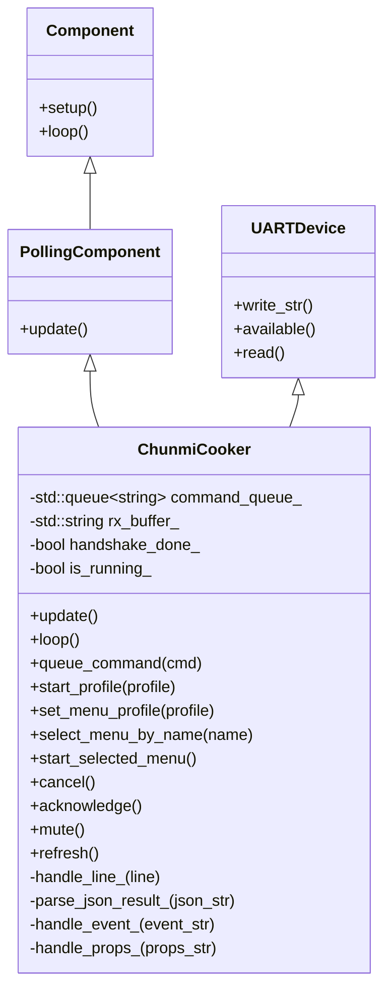

# ESPHome Implementation Architecture: `chunmi_cooker`

This document details the software architecture, component model, safety invariants, and Home Assistant entity mapping for the custom ESPHome component (`chunmi_cooker`) targeting the Xiaomi IH Rice Cooker (`IHFB01CM`).

---

## 1. Architectural Principles

1. **Strict Local Control**: All network interactions occur locally via ESPHome Native API or web interface; zero cloud dependencies.
2. **Read-First / Safety-Guarded Control**: The component respects the physical partition between IoT and appliance safety. It interacts with the cooker exclusively through high-level protocol commands (`set_start`, `set_menu`, `set_func`).
3. **Fail-Safe Operation**: If the ESP8285 crashes, boots into safe mode, or loses Wi-Fi connection, the host MCU's cooking cycle is unaffected.
4. **Asynchronous Command Queue**: Dispatches outgoing commands cleanly on incoming `get_down` ticks from the MCU without buffer collisions.

---

## 2. Component File Layout

The component is located under `components/chunmi_cooker/`:

```
components/chunmi_cooker/
├── __init__.py               # Core Python schema, UART device registration, ESPHome actions
├── chunmi_cooker.h           # C++ header: ChunmiCooker class, states, profiles, buttons, select
├── chunmi_cooker.cpp         # C++ implementation: UART loop, ArduinoJson parser, command queue
├── sensor.py                 # Sensors: temperature, remaining time, duration, delay time
├── text_sensor.py            # Text sensors: mode, stage, menu, last button, last event, versions
├── binary_sensor.py          # Binary sensors: pot present, error, auto keep-warm, lid open warning
├── button.py                 # Buttons: preset starters, start selected, cancel, mute, ack, refresh
└── select.py                 # Select: bidirectional menu profile picker
```

---

## 3. C++ Component Class Architecture



### 3.1 Lifecycle & Execution Loop
- **`setup()`**:
  - Initializes all entity states to known defaults.
  - Queues initial network status announcement: `down MIIO_net_change local\r`.
- **`update()` (Polling Interval, 3s)**:
  - Queues status query: `down get_prop "all"\r`.
  - If `is_running_`, also queues temperature history query: `down get_temp_history\r`.
- **`loop()` (Every ESPHome cycle)**:
  - Drains UART receive FIFO into `rx_buffer_`.
  - Splits incoming data on `\r\n` line delimiters.
  - Passes complete lines to `handle_line_()`.
  - On receiving `get_down`, pops the next command from `command_queue_` and transmits it, or sends `down none\r`.

---

## 4. Home Assistant Entity Model

| Entity Category | Entity Name | Type | Source / Action | Description |
| :--- | :--- | :--- | :--- | :--- |
| **Status** | Mode | `text_sensor` | Status Index 0 (`func`) | `waiting`, `running`, `autokeepwarm`, `error` |
| **Status** | Stage | `text_sensor` | Status Index 2 (`stage`) | Current cooking phase (e.g. `Idle`, `Boiling`, `Braising`, `Finished`) |
| **Status** | Menu | `text_sensor` | Status Index 1 (`menu`) | Selected recipe: `Standard Rice`, `Quick Rice`, `Porridge`, `Keep Warm`, etc. |
| **Status** | Last Button | `text_sensor` | `props button_pressed` | Last pressed button (physical or virtual: `start`, `cancel`, `wifi_reset`) |
| **Status** | Last Event | `text_sensor` | `event *` lines | Most recent hardware event/alarm notification |
| **Status** | Hardware Version | `text_sensor` | Status Index 9 (`version`) | Host MCU hardware revision (e.g. `v3`) |
| **Status** | MCU Version | `text_sensor` | Status Index 9 / handshake | Host MCU firmware revision (e.g. `v26`) |
| **Sensor** | Temperature | `sensor` | Status Index 3 / Temp History | Real-time temperature in °C (ambient when idle, pot temp when cooking) |
| **Sensor** | Remaining Time | `sensor` | Status Index 4 (`t_func`) | Remaining countdown minutes |
| **Sensor** | Program Duration | `sensor` | Status Index 6 (`t_cook`) | Total profile cooking duration in minutes |
| **Sensor** | Delay Time | `sensor` | Status Index 5 (`t_precook`) | Scheduled appointment delay in minutes |
| **Binary Sensor**| Inner Pot Present | `binary_sensor` | `event nopan` / Status | `ON` when inner pot is inserted, `OFF` when removed |
| **Binary Sensor**| Error | `binary_sensor` | Status / `event *` alarms | `ON` if any safety cutoff or hardware fault is active |
| **Binary Sensor**| Auto Keep Warm | `binary_sensor` | Status Index 7 (`setting`) | Auto keep-warm enabled |
| **Binary Sensor**| Lid Open Warning | `binary_sensor` | Status Index 7 (`setting`) | Lid open alarm enabled |
| **Select** | Menu Select | `select` | Sends `down set_menu "<profile>"\r` | Selects recipe profile without starting heating; mirrors physical menu button |
| **Control** | Cancel - Stop | `button` | Sends `down set_func "end02"\r` | Immediately cancels active cooking or warming cycle |
| **Control** | Start Selected Menu | `button` | Sends `down set_start "<profile>"\r` | Starts the currently selected menu profile |
| **Control** | Start Quick Rice | `button` | Sends `down set_start "<profile>"\r` | Starts Quick Rice (40 min) |
| **Control** | Start Standard Rice | `button` | Sends `down set_start "<profile>"\r` | Starts Standard Rice (60 min) |
| **Control** | Start Porridge | `button` | Sends `down set_start "<profile>"\r` | Starts Porridge (1h 30 min) |
| **Control** | Start Keep Warm | `button` | Sends `down set_start "<profile>"\r` | Starts Keep Warm |
| **Control** | Start Cooking | `button` | Sends `down set_start "<profile>"\r` | Starts Steaming / Cooking |
| **Control** | Start Cake | `button` | Sends `down set_start "<profile>"\r` | Starts Cake baking |
| **Control** | Start Sushi Rice (Experimental) | `button` | Sends `down set_start "<profile>"\r` | Starts 50-min Sushi Rice profile |
| **Control** | Start Express Rice (Experimental) | `button` | Sends `down set_start "<profile>"\r` | Starts 30-min Express Rice profile |
| **Control** | Acknowledge | `button` | Sends `down set_func "ack"\r` | Acknowledges active warning chime |
| **Control** | Mute Warnings | `button` | Sends `down set_func "nowarn"\r` | Suppresses recurring reminder beeps |
| **Control / Diagnostic** | Refresh Status | `button` | Sends `down get_prop "all"\r` | Triggers immediate status refresh |

### 4.1 Home Assistant Entity Categorization
Entities are structured via native ESPHome/Home Assistant `entity_category` tags to ensure clean separation on device pages and dashboards:
1. **Primary Controls & Actions** (Default category, rendered at top):
   - Menu Select (`select.menu_select`), Start Selected Menu, Cancel - Stop.
   - Quick Start Presets (Quick Rice, Standard Rice, Porridge, Keep Warm, Cooking, Cake, Sushi Rice [Experimental], Express Rice [Experimental]).
2. **Primary Status & Cooking Telemetry** (Default category, rendered under Sensors):
   - Remaining Time, Mode, Stage, Menu.
   - Temperature, Inner Pot Present, Auto Keep Warm, Lid Open Warning, Program Duration, Delay Time, Error.
3. **Configuration** (`entity_category: config`, grouped under Configuration card in HA):
   - Acknowledge Warning Chime (`button.acknowledge`).
   - Mute Warnings (`button.mute`).
4. **Diagnostics & Debug** (`entity_category: diagnostic`, tucked under Diagnostic card in HA):
   - Last Button, Last Event, Hardware Version, MCU Version, Refresh Status.

---

## 5. Built-in Safety Guards

- **Autonomous Host MCU Invariants**: Inverter frequency, IGBT switching, and thermal safety cutoffs remain fully guarded within the NXP LPC11xx MCU firmware.
- **Inner Pot Interlock**: The LPC11xx MCU autonomously pauses/prohibits induction heating if `nopan` is detected.
- **Fail-Safe Disconnect**: If the ESP module hangs or loses connection, the host MCU completes its active cycle or shuts down safely according to its watchdog.
