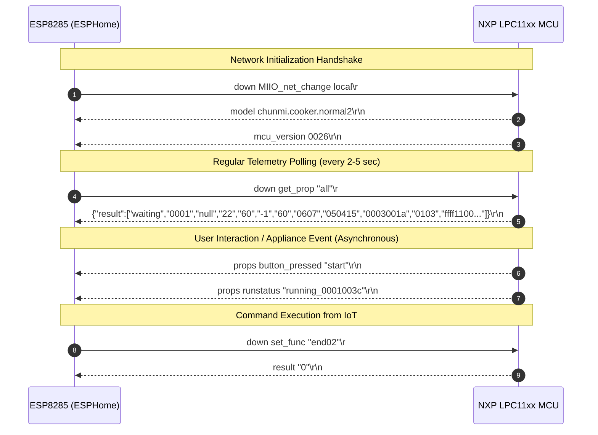

# Serial Protocol Specification: ESP8285 $\leftrightarrow$ LPC11xx MCU

This document specifies the serial communication protocol between the **Xiaomi MHCW03P Wi-Fi module (ESP8285)** and the **appliance host controller (NXP LPC1100 series ARM Cortex-M0 MCU)** on the Xiaomi IH Rice Cooker (`IHFB01CM` / `chunmi.cooker.normal2`).

---

## 1. Physical & Framing Layer

- **Interface**: Full-duplex asynchronous serial (UART).
- **ESP8285 Pins**: `GPIO13` (RX) and `GPIO15` (TX) via `system_uart_swap()`.
- **Baud Rate**: `115200` baud.
- **Data Bits**: 8.
- **Parity**: None (N).
- **Stop Bits**: 1.
- **Flow Control**: None.
- **Frame Delimiters**:
  - **Downlink (ESP $\rightarrow$ MCU)**: Terminated by carriage return (`\r`, ASCII `0x0D`).
  - **Uplink (MCU $\rightarrow$ ESP)**: Terminated by carriage return + line feed (`\r\n`, ASCII `0x0D 0x0A`).

---

## 2. Communication Model

The protocol combines **synchronous polling (request-response)** with **asynchronous event notifications**:



---

## 3. Downlink Command Reference (ESP $\rightarrow$ MCU)

All downlink commands are ASCII strings prefixed with `down ` and terminated by `\r`.

| Command String | Parameters | Description |
| :--- | :--- | :--- |
| `down get_prop "all"\r` | None | Queries the complete appliance status and sensor array. |
| `down MIIO_net_change local\r` | None | Notifies the MCU that Wi-Fi and local network connectivity are active. |
| `down MIIO_net_change offline\r` | None | Informs MCU that network connectivity was lost (causes Wi-Fi LED to blink or change color). |
| `down set_start "<profile>"\r` | `<profile>` (228 or 242 hex chars) | Initiates cooking using the specified cooking profile. |
| `down set_menu "<profile>"\r` | `<profile>` (228 or 242 hex chars) | Selects a recipe profile on the cooker without immediately activating the heater. |
| `down set_func "end02"\r` | None | Cancels the active cooking, warming, or timer state and returns to idle/waiting. |
| `down set_func "nowarn"\r` | None | Disables acoustic warning beeps. |
| `down set_func "ack"\r` | None | Acknowledges an active warning chime. |
| `down set_interaction "<cfg>" "<led>" "<lid>" "<alarm>"\r` | Hex parameters | Configures display timeout, lid open warning, and snooze delays. |
| `down get_temp_history\r` | None | Requests temperature log recorded during the active cooking cycle. |
| `down update_fw\r` | None | Puts the MCU into firmware update mode. |

---

## 4. Uplink Status Array Specification

In response to `down get_prop "all"\r`, the MCU returns a single-line JSON string:

```json
{"result":["waiting","0001","null","22","60","-1","60","0607","050415","0003001a","0103","ffff1100ffff011effff001e00001618"]}
```

The array contains exactly **12 elements**:

| Index | Field Name | Example Value | Format / Data Type | Semantic Meaning |
| :---: | :--- | :--- | :--- | :--- |
| **0** | `func` (Mode) | `"waiting"` | ASCII Enum | Primary operational state: `waiting` (idle), `running` (cooking), `autokeepwarm` (warm), `precook` (delayed timer), `pause`, `error`. |
| **1** | `menu` | `"0001"` | 4 Hex characters | Selected recipe ID (`0001` = Fine Rice / Jingzhu, `0002` = Quick Rice / Kuaizhu, `0003` = Porridge / Zhuzhou, `0004` = Keep Warm). |
| **2** | `stage` | `"null"` / `"02000000ff"` | String | `null` when idle. When cooking, a 10-char hex string: Byte 0 is Stage ID, Bytes 1–2 Rice ID, Byte 3 Taste profile. |
| **3** | `temp` | `"22"` / `"031e0b230000"` | String / Encoded | **Idle / Waiting**: Current bottom NTC pan thermistor temperature in °C as decimal string (e.g. `"22"` = 22°C). **Cooking (`running`)**: Switches to a 12-char hex string containing elapsed/remaining execution timestamps; live temperature must be read via `get_temp_history`. |
| **4** | `t_func` | `"60"` | Decimal String | Remaining duration of current phase in minutes (countdown timer). |
| **5** | `t_precook` | `"-1"` / `"750"` | Signed Decimal String | Scheduled appointment delay in minutes. `"-1"` indicates no delayed timer is set. |
| **6** | `t_cook` | `"60"` | Decimal String | Total duration of the selected cooking program in minutes. |
| **7** | `setting` | `"0607"` | 4 Hex characters | 16-bit configuration bitmask. Bit 2 (`0x04`): Auto keep-warm toggle. Bit 3 (`0x08`): Lid open warning buzzer feature enabled (configuration toggle, not a physical microswitch). |
| **8** | `delay` | `"050415"` | 6 Hex characters | Interaction timeouts (hex): Byte 0 = LED off timeout (sec), Byte 1 = Lid open limit (sec), Byte 2 = Lid alarm delay (sec). |
| **9** | `version` | `"0003001a"` | 8 Hex characters | Hardware version (upper 16 bits = `0x0003`) and MCU firmware version (lower 16 bits = `0x001a` / decimal 26). |
| **10**| `favorite` | `"0103"` | 4 Hex characters | Stored favorite profile ID and settings. |
| **11**| `custom` | `"ffff11..."` | 32 Hex characters | Encoded custom appointments and durations for presets. |

### 4.1 Cooking Stages (Stage Field Byte 0)

| Stage ID | Stage Name | Description |
| :---: | :--- | :--- |
| `0x00` | Rapid Preheat | Temperature ramp-up to hydrate rice grains gradually. |
| `0x01` | Water Absorbing | Controlled medium heat to optimize grain saturation. |
| `0x02` | Boiling | High-power heating cycle to reach a rolling boil. |
| `0x03` | Gelatinizing | High-temperature steam holding phase to develop sweetness. |
| `0x04` | Braising | Water absorption phase at steady moderate temperature. |
| `0x07` | High-Temp Boil | Full-power burst heating. |
| `0x08` | Flavor Development | Cyclic temperature oscillation for optimal texture. |
| `0x10` | Finished | Program completed; transitions automatically to keep-warm. |

### 4.2 Temperature History Stream (`down get_temp_history`)

When the appliance is actively cooking (`is_running_ == true`), real-time temperature is queried using `down get_temp_history\r`. 

- **Idle Response**: When not cooking, the MCU replies with `result "0"\r\n`.
- **Active Cooking Response**: The MCU returns an open-ended hex byte stream without a closing quote:
  ```text
  result "161515161c242a3031302f2eaa2f2f2e2f...\r\n
  ```
- **Data Structure**:
  - Each byte (2 hex characters) represents a bottom pan NTC temperature sample in °C (e.g., `0x16` = 22°C, `0x3c` = 60°C, `0x64` = 100°C), recorded approximately every 10–15 seconds.
  - **Stage Delimiter `0xAA`**: The byte `0xAA` (170) is emitted by the MCU firmware whenever the cooking cycle advances to a new cooking stage. Parsers must skip `0xAA` when inspecting recent samples.
  - **Payload Length**: As cooking progresses over 60–90 minutes, the response stream grows up to 500+ characters (~250 bytes). UART receive buffers and software line buffers must be sized to at least 1024 bytes to prevent frame truncation and buffer overflow.


---

## 5. Asynchronous Events & Notifications (MCU $\rightarrow$ ESP)

The host MCU pushes spontaneous events on the serial line without waiting for a poll command.

### 5.1 Appliance Status Updates
- `props button_pressed "<button>"\r\n`: A physical button on the lid was pressed (e.g., `start`, `cancel`, `select`, `timer`).
- `props runstatus "<status>_<payload>"\r\n`: State transition broadcast. Payload structure: `<prefix>_<recipe_8hex><remaining_min_4hex><stage_progress_4hex><code_2hex><param_2hex><param_2hex>`.
  - `notice_<payload>`: Active cooking alert. Notice code byte indicates the alert type:
    - `0x01`: Add Ingredient Notice (recipe step alert)
    - `0x02`: Stir Notice
    - `0x03`: Lid Opened Alert (emitted when lid is opened during cooking)
    - `0x04`: Close Lid Reminder (warning buzzer if lid remains open)
    - `0x06`: Steam Valve Notice
    - `0x07`: Pressure Notice
  - `fire_<payload>`: Heating element active or resumed.
  - `start_<payload>` / `startp_<payload>`: Cooking program initiated.
  - `cancel_<payload>`: Cooking program cancelled.
  - `pause_<payload>`: Cooking program paused.
  - `resume_<payload>` / `resumep_<payload>`: Cooking program resumed.
  - `finish_<payload>` / `finisha_<payload>`: Cooking program finished.
- `props work_status "<status>"\r\n`: Cooker operating phase update (`standby`, `cooking-quickly`, `preorder`, etc.).
- `event riceready "%04x"\r\n`: Emitted when cooking program completes and ready chime plays.

### 5.2 Sensor & Safety Alarms
The LPC11xx MCU executes continuous hardware safety diagnostics and broadcasts alarms if faults occur:

| Event String | Description | Action Required |
| :--- | :--- | :--- |
| `event nopan\r\n` | The inner cooking pot was lifted or removed during cooking. | Heater pauses immediately until pot is replaced. |
| `event bottomsensorbad\r\n` | Bottom center pan NTC thermistor is open-circuit or shorted. | Inverter locked out; fatal hardware error. |
| `event topsensorbad\r\n` | Lid temperature NTC thermistor is disconnected or faulty. | Inverter locked out; fatal hardware error. |
| `event igbtsensorbad\r\n` | Power transistor (IGBT) heatsink thermistor faulty. | Inverter locked out. |
| `event botsensorhigh\r\n` | Pot bottom over-temperature protection tripped. | Emergency heater shutdown (dry boil protection). |
| `event topsensorhigh\r\n` | Lid over-temperature protection tripped. | Heater power reduced or stopped. |
| `event igbtsensorhigh\r\n` | Resonant inverter IGBT heatsink over-temperature. | Fan boosted, induction drive throttled. |
| `event hvprotection\r\n` | AC mains over-voltage detected. | Safety shutdown. |
| `event lvprotection\r\n` | AC mains under-voltage / brownout detected. | Safety shutdown. |
| `event wirebroken\r\n` | Induction coil harness or thermistor wiring broken. | Immediate lockout. |

### 5.3 System & Hardware Lifecycle Events
- `reboot\r\n`: Emitted by host MCU upon logic reset or power-on.
- `restore\r\n`: Emitted when the physical Wi-Fi reset button (`KEY` pin) is held. Causes the ESP to switch to Fallback AP / Captive Portal mode and send `down MIIO_net_change unprov\r` (orange pulsing LED).
- `factory\r\n`: Emitted during factory self-test entry.

---

## 6. Command Execution Return Codes

When receiving configuration or command frames (`set_start`, `set_func`, `set_interaction`), the MCU responds with simple status strings:

| Response String | Meaning |
| :--- | :--- |
| `result "0"\r\n` | Command accepted and executed successfully. |
| `result "ready"\r\n` | Subsystem ready for next operation. |
| `result "busy"\r\n` | Subsystem currently executing another operation; retry later. |
| `ok\r\n` | Acknowledged. |
| `error\r\n` | Invalid command syntax, forbidden state, or parameter out of bounds. |
