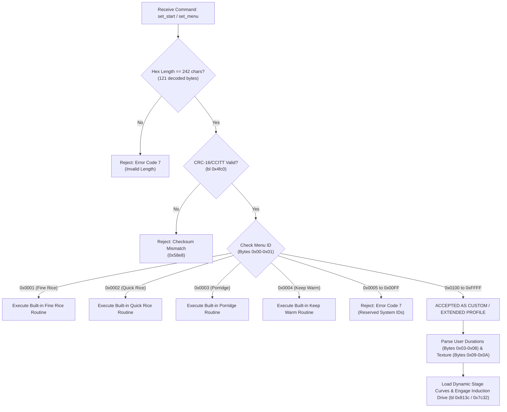

# Reverse Engineering: Chunmi IH Rice Cooker Profile Format & Stage Curves

This document details the binary format of the cooking profile strings, the **NXP LPC11xx MCU firmware acceptance rules** (reverse-engineered from the microcontroller binary disassembly), and the **decoded stage curves for all default profiles** on the **Xiaomi IH Rice Cooker** (`IHFB01CM` / `chunmi.cooker.normal2`).

Profiles are transmitted from the ESP8285 Wi-Fi module to the host NXP LPC11xx MCU via UART using:
* `down set_start "<profile>"\r` (Initiates cooking cycle immediately)
* `down set_menu "<profile>"\r` (Selects profile on the lid display without engaging the heater)

---

## 1. MCU Firmware Profile Acceptance Rules

Disassembly of the MCU firmware command handlers (`set_menu` at `0x5642` and `set_start` at `0x57fa`) reveals the strict validation logic executed by the appliance microcontroller:



### 1.1 Summary of Accepted Custom Profiles
1. **Length Constraint**: The payload **must be strictly 242 hexadecimal characters** (121 bytes). Profiles of length 228 (used in older pressure cooker models) are rejected with error code 7.
2. **Checksum Constraint**: The final 2 bytes must match the big-endian **CRC-16/CCITT-FALSE** computed across the first 119 bytes.
3. **Menu ID Rules**:
   - `0x0001` - `0x0004`: Hardcoded built-in programs (Standard Rice, Quick Rice, Porridge, Keep Warm).
   - `0x0005` - `0x00FF`: **Reserved by MCU logic**. The MCU performs `cmp r0, #255; bls error`, rejecting any ID in this range.
   - **`0x0100` - `0xFFFF`**: **Accepted as Custom / Extended Profiles!**
     - Stock extensions use `0x0100` (Cake), `0x0103` (Steam / Cooking), and `0x0104` (Sweet Rice).
     - Any third-party, Home Assistant, or app-generated profile must use an ID $\ge \mathbf{0x0100}$.
4. **Duration & Bounds Checks**:
   - For custom profiles, the default duration is read from Bytes `0x03` - `0x04` (`HH:MM`).
   - If Byte `0x02` has bit 1 set, the cooker enables timer adjustment on the lid buttons between Min (`0x07-0x08`) and Max (`0x05-0x06`).
   - If Min and Max are zero, the duration is locked as fixed.
5. **Rice Type & Texture Adaptation**:
   - When Byte `0x02` bit 6 (`0x40`) or bit 7 (`0x80`) is set, the MCU extracts:
     - **Texture / Hardness**: Byte `0x09` (bits 0–4: `0` = Soft, `1` = Normal, `2` = Firm).
     - **Rice Variety**: Byte `0x0A` (bits 0–5: variety index corresponding to grain starch ratios).

---

## 2. Profile Memory Layout

```
+--------+--------+--------------------------------------------------------+
| Offset | Length | Section Description                                    |
+--------+--------+--------------------------------------------------------+
| 0x00   | 12 B   | Profile Header & Duration Limits                       |
| 0x0C   | 14 B   | Stage 1: Rapid Preheat                                 |
| 0x1A   | 14 B   | Stage 2: Water Absorption                              |
| 0x28   | 14 B   | Stage 3: Rolling Boil                                  |
| 0x36   | 14 B   | Stage 4: High-Temp Gelatinization (Dynamic Boil-off)   |
| 0x44   | 47 B   | Stage 5: Braising / Simmering & Inverter PWM Hold      |
| 0x73   | 4 B    | Null Padding (0x00000000)                              |
| 0x77   | 2 B    | CRC-16/CCITT-FALSE Checksum                            |
+--------+--------+--------------------------------------------------------+
Total: 121 Bytes (242 Hex Characters)
```

### 2.1 14-Byte Stage Record Structure (Stages 1–4)

Each phase segment (`0x0C`–`0x43`) conforms to this 14-byte descriptor:

| Sub-Offset | Field Name | Type | Description |
| :---: | :--- | :--- | :--- |
| `+0x00 - +0x01` | **Phase Duration** | `uint16_t` (BE) | Timeout in seconds (e.g. `0x00A0` = 160s, `0x012D` = 300s). Value `0xFFFF` indicates dynamic slope hold (countdown pauses until water boil-off is detected by the bottom NTC). |
| `+0x02 - +0x03` | **Target Pan Temp** | `uint16_t` (BE) | Bottom center NTC threshold in °C (e.g. `0x0069` = 105°C, `0x0070` = 112°C). |
| `+0x04` | **Stage Index** | `uint8_t` | Operating stage index (`0x03` = preheat, `0x04` = absorption, `0x05` = boiling, `0x06` = gelatinization). |
| `+0x05` | **Heating Ramp Mode** | `uint8_t` | `0x00`: Constant temperature hold<br>`0x01`: Linear PID temperature ramp |
| `+0x06 - +0x07` | **Lid Heater Target** | `uint16_t` (BE) | Upper lid anti-condensation heater target (`0x0373` = 115°C, `0x0374` = 116°C). |
| `+0x08 - +0x09` | **Intermittent Duty** | `uint16_t` (BE) | Low-power pulsation duty parameter. |
| `+0x0A - +0x0B` | **Stage Delimiter** | `uint16_t` (BE) | Phase boundary delimiter (`0x085A`, `0x095A`, `0x0A5A`, `0x0C5A`). |
| `+0x0C - +0x0D` | **Interlock Flags** | `uint16_t` (BE) | Safety interlock status (`0x0200`, `0x0400`, `0x0401`). |

---

## 3. Decoded Stage Curves for Default Profiles

### 3.1 Fine Rice (*Jingzhu*, Menu `0x0001` - 60 Minutes)
Designed for optimal starch gelatinization, sweetness development, and fluffy texture:

```
[00:00] -- Preheat (160s @ 105°C) -> [02:40]
[02:40] -- Water Absorbing (235s @ 107°C) -> [06:35]
[06:35] -- Rolling Boil (300s @ 110°C) -> [11:35]
[11:35] -- Gelatinization (Dynamic Boil-off @ 112°C, ~26m) -> [37:55]
[37:55] -- Braising & Steam Holding (1325s / 22m @ 90°C) -> [60:00]
[60:00] -- Transition to Auto Keep-Warm (73°C)
```

| Phase | Duration | Target Pan Temp | Lid Target | Description |
| :--- | :---: | :---: | :---: | :--- |
| **Stage 1: Rapid Preheat** | 160 sec (2m 40s) | 105°C | 115°C | Initial temperature ramp to begin warming grain core without thermal shock. |
| **Stage 2: Water Absorption** | 235 sec (3m 55s) | 107°C | 116°C | Controlled medium-power hold to maximize water penetration into rice starch. |
| **Stage 3: Rolling Boil** | 300 sec (5m 00s) | 110°C | 116°C | Full inverter induction burst to reach rolling boil and agitate grains evenly. |
| **Stage 4: Gelatinization** | Dynamic (`0xFFFF`) | 112°C | 118°C | Intense steam holding. Countdown halts until water is fully absorbed and bottom NTC rises to 112°C. |
| **Stage 5: Braising & Simmer** | 1325 sec (22m 05s) | 90°C | 110°C | Low-power simmering to settle grains, develop natural sugars, and vent excess steam. |
| **Completion** | — | 73°C | 78°C | Transitions automatically to `autokeepwarm`. |

---

### 3.2 Quick Rice (*Kuaizhu*, Menu `0x0002` - 40 Minutes)
Accelerated cooking curve with shortened preheat and absorption phases:

```
[00:00] -- Rapid Preheat (210s @ 105°C) -> [03:30]
[03:30] -- Fast Absorption (300s @ 107°C) -> [08:30]
[08:30] -- Rolling Boil (386s @ 110°C) -> [14:56]
[14:56] -- Gelatinization (Dynamic Boil-off @ 112°C, ~24m) -> [39:20]
[39:20] -- High-Speed Braising (40s @ 90°C) -> [40:00]
[40:00] -- Transition to Auto Keep-Warm (73°C)
```

| Phase | Duration | Target Pan Temp | Lid Target | Description |
| :--- | :---: | :---: | :---: | :--- |
| **Stage 1: Rapid Preheat** | 210 sec (3m 30s) | 105°C | 115°C | Steeper heating ramp to reach soaking temperature quickly. |
| **Stage 2: Fast Absorption** | 300 sec (5m 00s) | 107°C | 116°C | Shortened hydration phase. |
| **Stage 3: Rolling Boil** | 386 sec (6m 26s) | 110°C | 116°C | Extended high-power boil phase to compensate for shorter soaking. |
| **Stage 4: Gelatinization** | Dynamic (`0xFFFF`) | 112°C | 118°C | Full-power boil-off detection. |
| **Stage 5: Rapid Finish** | 40 sec | 90°C | 110°C | Minimal steam settling before chime. |
| **Completion** | — | 73°C | 78°C | Transitions automatically to `autokeepwarm`. |

---

### 3.3 Porridge (*Zhuzhou*, Menu `0x0003` - Default 1h 30m, Adjustable 40m–4h)
Gentle thermal curve strictly limited to 85°C–87°C to prevent starch boil-over:

```
[00:00] -- Gentle Ramp (400s @ 85°C) -> [06:40]
[06:40] -- Low-Temp Absorption (440s @ 85°C) -> [14:00]
[14:00] -- Slow Simmer (480s @ 86°C) -> [22:00]
[22:00] -- Steady Simmer (Dynamic @ 87°C, user duration) -> [Finish]
[Finish] -- Transition to Auto Keep-Warm (73°C)
```

| Phase | Duration | Target Pan Temp | Ambient Offset | Description |
| :--- | :---: | :---: | :---: | :--- |
| **Stage 1: Gentle Ramp** | 400 sec (6m 40s) | 85°C (`0x55`) | +22°C | Slow temperature rise to avoid sticking and early boil-over. |
| **Stage 2: Hydration** | 440 sec (7m 20s) | 85°C (`0x55`) | +25°C | Moderate heat soaking. |
| **Stage 3: Controlled Simmer** | 480 sec (8m 00s) | 86°C (`0x56`) | +32°C | Low bubbling without foaming up to the lid valve. |
| **Stage 4: Long Simmer** | Dynamic (`0xFFFF`) | 87°C (`0x57`) | +34°C | Sustained simmer for the remaining user-configured timer (up to 4 hours). |
| **Completion** | — | 73°C | — | Transitions to `autokeepwarm`. |

---

### 3.4 Keep Warm (*Baowen*, Menu `0x0004` - Up to 24 Hours)
* **Stage Curve (`0x0C`–`0x47`)**: Zeroed out (`0x00`).
* **Thermal Hold**: Single-stage closed-loop thermal regulation at **73°C** (`0x49`).
* **Lid Heater**: Modulated at **78°C** (`0x4E`) to prevent moisture from condensing on the underside of the lid and dripping back onto the food.
* **Duration**: Default 24 hours (`18:00`), adjustable down to 1 minute.

---

### 3.5 Cake (*Cake*, Menu `0x0100` - 60 Minutes)
* **Stage Curve (`0x0C`–`0x47`)**: Zeroed out (`0x00`).
* **Baking Hold**: Fixed steady temperature hold at **120°C** (`0x78`) using moderate induction pulses.
* **Keep-Warm**: **Disabled** (Byte `0x02` has bit 5 cleared). Cooker chimes and switches directly to idle `waiting` to prevent drying out or burning the cake.
* **Duration**: Default 60 minutes (`01:00`), adjustable between 40 min and 60 min.

---

### 3.6 Steam / Cooking (*Cooking*, Menu `0x0103` - 30 Minutes)
* **Stage Curve (`0x0C`–`0x47`)**: Zeroed out (`0x00`).
* **Steam Hold**: Full-power continuous boil at **100°C** (`0x64`).
* **Steam Vent**: Solenoid held open (Byte `0x02` bit 6 set).
* **Keep-Warm**: Disabled.
* **Duration**: Default 30 minutes (`00:1E`), adjustable between 10 min and 60 min.

---

### 3.7 Sushi Rice (*Sushi Rice*, Menu `0x0105` - 50 Minutes) [EXPERIMENTAL]

> [!WARNING]
> This is a custom synthesized profile demonstrating the MCU's custom profile engine (`Menu ID >= 0x0100`). It is tagged as **(Experimental)** across the Home Assistant UI, ESPHome YAML, and firmware.

Optimized specifically for short-grain Japanese sushi rice (*shari*): shorter soaking phase to prevent starch mushiness, strong boiling, and controlled steam braising for firm (*katame*) texture with distinct grains.

```
[00:00] -- Rapid Preheat (120s @ 105°C) -> [02:00]
[02:00] -- Controlled Absorption (180s @ 107°C) -> [05:00]
[05:00] -- Rolling Boil (320s @ 110°C) -> [10:20]
[10:20] -- High-Temp Boil-off (Dynamic @ 112°C, ~24m) -> [35:00]
[35:00] -- Dry Braising & Settle (900s / 15m @ 90°C) -> [50:00]
[50:00] -- Transition to Auto Keep-Warm (73°C)
```

| Phase | Duration | Target Pan Temp | Lid Target | Description |
| :--- | :---: | :---: | :---: | :--- |
| **Stage 1: Rapid Preheat** | 120 sec (2m 00s) | 105°C | 115°C | Quick temperature elevation to warm the pot evenly. |
| **Stage 2: Short Absorption** | 180 sec (3m 00s) | 107°C | 116°C | Shortened hydration so grains do not absorb excess water, preserving core firmness. |
| **Stage 3: Rolling Boil** | 320 sec (5m 20s) | 110°C | 116°C | Full-power induction boil to separate grains cleanly. |
| **Stage 4: Gelatinization** | Dynamic (`0xFFFF`) | 112°C | 118°C | Dynamic boil-off until water is absorbed and pan reaches 112°C. |
| **Stage 5: Dry Braising** | 900 sec (15m 00s) | 90°C | 110°C | Extended low-heat resting phase to dry the grain surface for vinegar dressing. |
| **Completion** | — | 73°C | 78°C | Transitions to `autokeepwarm`. |

---

### 3.8 Express Rice (*Express Rice*, Menu `0x0106` - 30 Minutes) [EXPERIMENTAL]

> [!WARNING]
> This profile targets the ~30-minute cooking times common to basic cookers on the European market. Because the soaking and hydration phases are compressed to the bare minimum, it is recommended to either:
> 1. Pre-soak rice in water for 15 minutes before cooking, or
> 2. Use with Jasmine / Basmati varieties (which naturally require less soaking than short-grain rice).

```
[00:00] -- Fast Preheat (90s @ 105°C) -> [01:30]
[01:30] -- Brief Hydration (120s @ 107°C) -> [03:30]
[03:30] -- Rolling Boil (300s @ 110°C) -> [08:30]
[08:30] -- High-Power Boil-off (Dynamic @ 112°C, ~15m 30s) -> [24:00]
[24:00] -- Fast Steam Settle (360s / 6m @ 90°C) -> [30:00]
[30:00] -- Transition to Auto Keep-Warm (73°C)
```

| Phase | Duration | Target Pan Temp | Lid Target | Description |
| :--- | :---: | :---: | :---: | :--- |
| **Stage 1: Fast Preheat** | 90 sec (1m 30s) | 105°C | 115°C | Rapid initial heat ramp to bring pot up to temperature immediately. |
| **Stage 2: Brief Absorption** | 120 sec (2m 00s) | 107°C | 116°C | Compressed soak phase. |
| **Stage 3: Rolling Boil** | 300 sec (5m 00s) | 110°C | 116°C | Full-power induction boil. |
| **Stage 4: High-Power Boil-off** | Dynamic (`0xFFFF`) | 112°C | 118°C | Vigorous boil until water is evaporated (~15.5m). |
| **Stage 5: Fast Settle** | 360 sec (6m 00s) | 90°C | 110°C | Short steam holding phase before ready chime. |
| **Completion** | — | 73°C | 78°C | Transitions to `autokeepwarm`. |

---

## 4. Python Profile Generator & Validator

A CLI helper script is available at [`scripts/generate_custom_profile.py`](../scripts/generate_custom_profile.py) to generate custom profiles and validate hex strings according to MCU firmware rules.

### 4.1 Running the Script

Use `uv run` to execute the script in the project environment:

```sh
# Show help and all available options
uv run scripts/generate_custom_profile.py --help
```

### 4.2 Validating Existing Profiles

Verify that a 242-character hex profile string satisfies length, CRC-16 checksum, and Menu ID requirements:

```sh
uv run scripts/generate_custom_profile.py validate "<HEX_PROFILE_STRING>"
```

To validate all known factory and experimental stock profiles at once:

```sh
uv run scripts/generate_custom_profile.py stock
```

### 4.3 Generating Custom Profiles

> [!IMPORTANT]
> The Menu ID must be $\ge \mathbf{0x0100}$ (256 decimal). Values between `0x0001` and `0x0004` are built-in MCU programs, and values between `0x0005` and `0x00FF` are reserved and will be rejected with MCU Error Code 7.

#### Example 1: Custom Steam / Cooking Profile (45 Minutes, No Keep-Warm)
```sh
uv run scripts/generate_custom_profile.py generate \
  --menu-id 0x0110 \
  --minutes 45 \
  --no-keepwarm
```

#### Example 2: Custom Rice Profile Based on Fine Rice Template (50 Minutes with Auto Keep-Warm)
```sh
uv run scripts/generate_custom_profile.py generate \
  --menu-id 0x0120 \
  --minutes 50 \
  --keepwarm \
  --template fine_rice
```

#### Example 3: Adjustable Duration Profile (30 min nominal, adjustable between 20 min and 60 min)
```sh
uv run scripts/generate_custom_profile.py generate \
  --menu-id 0x0130 \
  --minutes 30 \
  --min-minutes 20 \
  --max-minutes 60
```

### 4.4 Using Generated Profiles in ESPHome & Home Assistant

Once generated, you can trigger cooking with the custom profile string using:

1. **Home Assistant Action / Service**:
   Call `esphome.<node_name>_send_raw_command` with `down set_start "<PROFILE_HEX>"`:
   ```yaml
   action: esphome.xiaomi_rice_cooker_send_raw_command
   data:
     command: 'down set_start "011080002D00000000008002..."'
   ```

2. **ESPHome YAML Automations**:
   ```yaml
   on_...:
     - chunmi_cooker.start:
         profile: "011080002D00000000008002..."
   ```