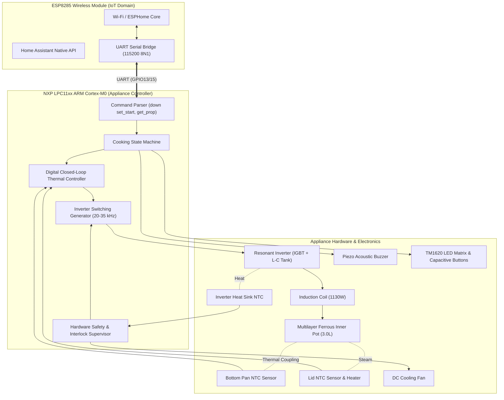

# Appliance Control & Thermodynamic Principles: How the Host MCU Cooks Rice

This research document explains how the **NXP LPC1100 series ARM Cortex-M0 Host Microcontroller (IC1)** controls the **Xiaomi IH Rice Cooker** (`IHFB01CM` / `chunmi.cooker.normal2`), detailing the electrical hardware architecture, the physics of induction heating, sensor feedback loops, and the thermodynamic execution of rice cooking curves.

---

## 1. System Architecture & Domain Separation

The rice cooker operates on an asymmetric dual-processor architecture:



### Architectural Distinction
* **The ESP8285 does not cook the rice**: It has no analog inputs connected to the thermistors and no digital lines to the power electronics. If the ESP8285 hangs, crashes, or is reflashed mid-cycle, the host MCU continues cooking uninterrupted.
* **The MCU is the autonomous master**: It enforces all physical invariants, modulates power at microsecond intervals, and directly drives the high-voltage induction electronics.

---

## 2. Induction Heating Physics & Power Electronics

Unlike resistive rice cookers that heat a hotplate via thermal conduction, the IH rice cooker transforms the inner cooking pot itself into the heat source:

### 2.1 The Quasi-Resonant Inverter Topology
1. **Mains Rectification**: 230V AC mains is rectified to DC via a bridge rectifier and filtered by an inductor/capacitor EMI filter.
2. **L-C Tank Circuit**: The primary induction coil ($L \approx 80\text{--}120\ \mu\text{H}$) forms a resonant tank circuit with high-voltage polypropylene resonant capacitors ($C \approx 0.22\text{--}0.33\ \mu\text{F}$).
3. **IGBT Switch**: An insulated-gate bipolar transistor (IGBT, typically 1200V / 25A–40A rated) switches the tank circuit to ground.
4. **Resonant Oscillation**: When the IGBT turns off, the magnetic energy stored in the coil rings into the capacitor, creating a high-voltage resonant pulse (up to 900V–1100V peak across the collector-emitter junction).
5. **Magnetic Induction**: The high-frequency alternating current generates a concentrated 20 kHz–35 kHz magnetic field that cuts through the ferrous layers of the inner pot.
6. **Joule & Hysteresis Heating**:
   $$\text{Power} = I_{\text{eddy}}^2 R_{\text{pot}} + P_{\text{hysteresis}}$$
   Eddy currents induced in the pot's outer iron/stainless-steel skin encounter electrical resistance, generating heat directly inside the vessel walls.

```
       +---[ Induction Coil ]---+
       |                        |
 +320V DC                       +---[ Resonant Cap ]---+
       |                        |                      |
       +--------( IGBT )--------+                      |
                   |                                   |
                  GND                                 GND
```

### 2.2 Microcontroller Power Modulation (PFM / PWM)
The LPC11xx MCU controls power using **Pulse Frequency Modulation (PFM)** with zero-voltage switching (ZVS):
* **Maximum Power (1130W)**: The switching frequency is set close to the natural resonant frequency of the L-C tank (~20 kHz). Maximum current circulates in the coil.
* **Partial Power (~300W–600W)**: The MCU increases the switching frequency (up to 32–35 kHz) away from resonance, reducing the circulating tank current.
* **Simmer / Ultra-Low Power (< 200W)**: The MCU duty-cycles the inverter into burst mode (e.g. 2 seconds ON, 4 seconds OFF) to maintain low braising temperatures without exceeding the lower operating limits of the resonant tank.

---

## 3. Sensor Array & Real-Time Feedback

The MCU continuously samples an analog sensor array via its on-chip 10-bit Successive Approximation ADC:

| Sensor | Physical Location | Role in Cooking Control |
| :--- | :--- | :--- |
| **Bottom Pan NTC** | Spring-loaded dome touching the exact center of the spherical pot base | Primary process variable ($PV$). Measures pot temperature, detects water boil-off inflection, and enforces dry-boil safety. |
| **Lid NTC** | Inside the upper lid behind the removable aluminum inner plate | Measures steam vapor temperature, detects boiling transitions, and controls the lid anti-condensation heater. |
| **IGBT Heatsink NTC** | Glued to the aluminum extrusion cooling the IGBT and bridge rectifier | Protects power semiconductor silicon. Drives the cooling fan PWM speed; throttles or shuts down induction if $T > 95^\circ\text{C}$. |
| **AC Mains Current Shunt** | In series with bridge rectifier DC negative rail | Measures instantaneous primary current. Used to compute real wattage ($V_{\text{mains}} \times I_{\text{mains}}$) and detect coil detuning. |
| **Zero-Cross Detector** | Connected across AC line input via comparator | Synchronizes inverter pulse bursts to mains zero-crossings to minimize grid harmonics and electrical noise. |

---

## 4. The Thermodynamics of Cooking Rice

Rice cooking is fundamentally a chemical and physical transformation of starch. Raw rice grains consist of crystalline **$\beta$-starch (amylose and amylopectin)** packed tightly into microscopic cells. Humans cannot digest raw $\beta$-starch, and it tastes chalky and hard.

Cooking converts $\beta$-starch into digestible, gelatinous **$\alpha$-starch**:
$$\beta\text{-starch (hard, crystalline)} \xrightarrow[\text{heat } (65^\circ\text{C--100}^\circ\text{C})]{\text{water hydration}} \alpha\text{-starch (soft, sweet, translucent)}$$

To achieve this transformation perfectly without burning or turning the grains to mush, the host MCU executes a **5-phase thermal curve**:

```
Temperature (°C)
120 |
    |                                   Gelatinization
110 |                                  (Boil-off Peak)
    |                                    [Stage 4]
100 |                        Rolling Boil: 100°C . - - - -
    |                          [Stage 3]       /          \   Braising & Rest
 90 |                                         /             \    [Stage 5]
    |                                        /                \ - - - - - - -
 80 |                                       /
    |                                      /                    Keep Warm
 70 |                 Water Absorption    /                     [73°C Hold]
    |    Preheat         [Stage 2]       /
 60 |   [Stage 1]       - - - - - - - - /
    |  - - - - - - - - /
 50 | /
 20 |/_________________________________________________________________
    0m        5m             12m         20m            40m        60m  Time
```

---

### Phase 1: Rapid Preheat & Soaking Hydration (Stage Index `0x00`)
* **Target Temperature**: 45°C–60°C.
* **Duration**: 2 to 4 minutes (120s–210s).
* **Thermal Objective**: Water cannot penetrate dry rice grains instantly. At cold temperatures, water takes over an hour to diffuse into the core. At temperatures above 65°C, surface starch gelatinizes immediately, forming a waterproof gelatinous shell that locks moisture out of the center.
* **MCU Action**: The MCU powers the induction coil at ~600W until the bottom NTC reads ~55°C, then drops power to hold this lukewarm bath. Water diffuses through the grain cell walls, swelling the grain core to ~25%–30% moisture content.

---

### Phase 2: Water Absorption & Starch Swelling (Stage Index `0x01`)
* **Target Temperature**: 60°C–65°C.
* **Duration**: 3 to 6 minutes (180s–300s).
* **Thermal Objective**: Grain enzymes (**$\alpha$-amylase** and **$\beta$-amylase**) become chemically active between 50°C and 65°C. These enzymes break down complex starches into maltose and simple sugars, naturally sweetening the rice before boiling begins.
* **MCU Action**: Holds steady medium induction power with moderate magnetic agitation, encouraging uniform saturation.

---

### Phase 3: Rolling Boil Ascent (Stage Index `0x02`)
* **Target Temperature**: 100°C rolling boil (Pan NTC threshold: ~107°C–110°C).
* **Duration**: 5 to 7 minutes (300s–386s).
* **Thermal Objective**: Rapidly transition from sugar development to rolling boiling.
* **MCU Action**: Full inverter throttle (**1130W**). The concentrated magnetic field at the bottom perimeter of the spherical pot creates violent toroidal thermal convection currents. Rice grains circulate continuously in 360° loops, preventing grain-to-grain clumping and ensuring uniform heat delivery across all layers.

---

### Phase 4: High-Temperature Gelatinization & Boil-Off Detection (Stage Index `0x03`)
* **Target Temperature**: Phase transition hold (`0xFFFF` dynamic timeout).
* **Duration**: Dynamic (~15 to 25 minutes depending on water volume and rice type).
* **The Physics of Boil-Off Detection**:
  - As long as liquid water remains in the pot, the temperature of the rice-water mixture **cannot exceed 100°C** at atmospheric pressure due to the latent heat of vaporization:
    $$\Delta H_{\text{vap}} \approx 2260\ \text{J/g}$$
    All electrical power injected by the induction coil is consumed by turning liquid water into steam.
  - The instant the rice grains absorb the last standing liquid water, this latent heat barrier vanishes.
  - Injected induction heat now directly warms the pot and rice grains, causing the temperature measured by the bottom NTC to break out of the 100°C plateau and climb rapidly:
    $$\frac{dT}{dt} > 0.15^\circ\text{C / sec} \quad \implies \quad T_{\text{pan}} \ge 112^\circ\text{C}$$
* **MCU Action**: The MCU firmware monitors this mathematical inflection point ($dT/dt$). The moment the bottom sensor breaks 112°C, the MCU knows with thermodynamic certainty that all free water is absorbed. It immediately cuts high-power induction to prevent scorching, completing the dynamic `0xFFFF` stage.

---

### Phase 5: Braising, Steam Settle & Gel Rest (*Mushi*) (Stage Index `0x04`)
* **Target Temperature**: 90°C pan hold; 110°C–115°C lid heater.
* **Duration**: 10 to 22 minutes (600s–1325s).
* **Thermal Objective**:
  - Moisture inside the grains redistributes evenly from the wet outer coat to the drier interior.
  - The surface starch firms up slightly, creating individual, glossy grains that separate cleanly without sticking together into mush.
* **MCU Action**:
  - Low-power pulsing induction bursts (~150W equivalent) hold the bottom at 90°C.
  - **Lid Heater Modulation**: The MCU energizes the resistive heating element in the upper lid to maintain the inner lid plate at ~110°C. Because the lid is hotter than the rising steam vapor, **water droplets cannot condense on the underside of the lid**, preventing cold water droplets from dripping down and creating soggy spots on the rice surface.

---

### Phase 6: Automatic Keep-Warm (*Baowen*)
* **Pan Hold Temperature**: **73°C** (`0x49`).
* **Lid Temperature**: **78°C** (`0x4E`).
* **Microbiological Invariant**: Food safety standards require cooked food to remain above the bacterial danger zone (**> 60°C**) to prevent the germination of *Bacillus cereus* spores.
* **Sensory Invariant**: If held above 76°C for prolonged periods, the Maillard reaction slowly accelerates, causing the rice to turn yellow, develop a stale smell, and dry out. The MCU regulates closed-loop control precisely between **71°C and 74°C**, maintaining warmth and food safety for up to 24 hours.

---

## 5. Hardware Safety Interlocks & Error Traps

The host MCU executes autonomous safety checks at an interrupt frequency of several kilohertz:

```
+---------------------+---------------------------------------------------------+
| Fault Condition     | Trigger & Microcontroller Safety Reaction               |
+---------------------+---------------------------------------------------------+
| Pot Lifted (nopan)  | Resonant tank impedance shift detected via current      |
|                     | shunt. Inverter gate drive disabled within 50 µs.       |
|                     | Emits "event nopan\r\n" and pauses timer.               |
+---------------------+---------------------------------------------------------+
| Dry Boil            | Bottom pan NTC exceeds 145°C. Immediate emergency shut- |
| (botsensorhigh)     | down of induction drive. Emits "event botsensorhigh".   |
+---------------------+---------------------------------------------------------+
| IGBT Overtemp       | Heatsink NTC exceeds 95°C. Fan boosted to 100% PWM.     |
| (igbtsensorhigh)    | Inverter throttled to 50% power. Lockout if T > 105°C.  |
+---------------------+---------------------------------------------------------+
| Grid Brownout / OV  | AC mains voltage sampled outside 180V–260V RMS.        |
| (lv / hvprotection) | Inverter safely disabled until voltage normalizes.      |
+---------------------+---------------------------------------------------------+
| Sensor Disconnect   | NTC ADC counts read 0x000 (short) or 0x3FF (open).      |
| (sensorbad)         | Permanent safety lockout until appliance reboot.        |
+---------------------+---------------------------------------------------------+
```

---

## 6. Summary: The Intelligence is in the MCU

The Xiaomi IH Rice Cooker's cooking performance is governed entirely by the autonomous state machine and closed-loop PID control running inside the **NXP LPC11xx MCU**:

1. **Precision Energy Delivery**: It uses high-frequency resonant induction to turn the cooking vessel itself into a distributed, fast-responding heater.
2. **Thermodynamic Sensing**: Rather than relying on simple timers, it tracks physical phase changes (water boil-off inflection points) through real-time $dT/dt$ slope detection.
3. **Condensation Control**: It coordinates dual-zone heating (induction base + upper lid resistive element) to eliminate moisture drip.
4. **Resilient Architecture**: By isolating all power, thermal, and safety routines onto the Cortex-M0 MCU, the cooker functions reliably regardless of Wi-Fi or IoT network connectivity.
